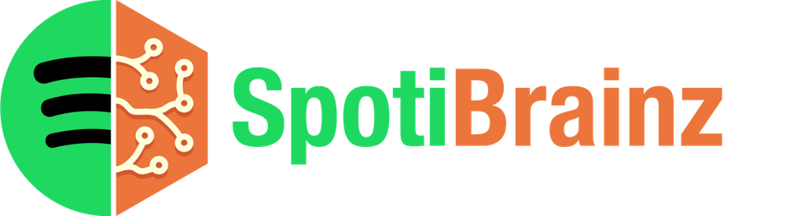

<p align="center">
  
</p>

Copies your [ListenBrainz](https://listenbrainz.org) playlists to Spotify and keeps them up to date, automatically. You set it up once in a web page, then it runs on its own in a small Docker container.

## What it syncs

Every kind of playlist can be switched on or off, renamed, and made public or private.

- **Weekly Exploration, Weekly Jams and Daily Exploration** (from ListenBrainz Daily Jams). For each one:
  - this week's / today's playlist
  - last week's / yesterday's playlist
  - an optional archive of past ones, such as "Weekly Exploration - 2026-10-19", kept for 1 week up to forever
- **Generated Jams:** 50 songs picked from your ListenBrainz recommendations, with your own filters (skip recently played songs, max songs per artist, familiar or new music).
- **Any ListenBrainz playlist:** paste a link, then keep it updated or import it once.
- **Yearly playlists** like Top Discoveries.

New weekly and daily playlists reach Spotify within minutes of ListenBrainz publishing them. Songs you've marked as "hated" on ListenBrainz are left out.

## Quick start

You need [Docker](https://docs.docker.com/get-docker/) with Docker Compose, a ListenBrainz account and a Spotify Premium account.

**1. Create a folder with a `docker-compose.yml` file:**

```yaml
services:
  spotibrainz:
    image: alfonsocasadodiez/spotibrainz:latest
    container_name: spotibrainz
    restart: unless-stopped
    ports:
      - "8888:8888"
    environment:
      TZ: Europe/Madrid    # your timezone
    volumes:
      - ./data:/data
      - keys:/keys

volumes:
  keys:
```

**2. Start it:**

```sh
docker compose up -d
```

**3. Open http://localhost:8888** and follow the steps on the page:

1. Enter your ListenBrainz username.
2. Create a free Spotify developer app (the page walks you through it), paste its keys and click **Connect Spotify**.
3. Choose your playlists.
4. Optionally, change the schedule.

The first sync starts as soon as Spotify is connected. After that it runs by itself, including after reboots.

## Configuration

Everything is configured on the setup page. These optional settings go under `environment:` in `docker-compose.yml`:

| Setting | Default | What it does |
|---|---|---|
| `TZ` | `UTC` | Your timezone, e.g. `Europe/Madrid`. Schedules and release-morning checks use it. |
| `WEB_PASSWORD` | none | Protects the setup page with a password. Recommended if others can reach it. |
| `SECRET_KEY` | generated | Your own long random encryption key, instead of the one generated in the `keys` volume. |
| `WEB_PORT` | `8888` | Port the setup page listens on. Remember to update your `docker-compose.yml` accordingly. |

## Updating

```sh
docker compose pull
docker compose up -d
```

## Running on a NAS or home server

Open `http://<server-ip>:8888` instead of localhost. After you approve Spotify access, your browser shows "This site can't be reached". That's expected: copy the address from the address bar and paste it into the box under **Connect Spotify**.

The image runs on `amd64` and `arm64` (e.g. Raspberry Pi 4/5 and most modern NAS devices).

## Good to know

- **No playlists showing up?** ListenBrainz needs your listening history first. Connect Spotify in your [ListenBrainz settings](https://listenbrainz.org/settings/) and give it a few days.
- **No Daily Exploration?** Follow [troi-bot](https://listenbrainz.org/user/troi-bot/) on ListenBrainz.
- **"Yesterday's" starts empty.** ListenBrainz doesn't keep past Daily Jams, so it fills in the day after you start.
- **Archive folders:** Spotify doesn't let apps create folders. Create one in the Spotify app and drag the archived playlists in.
- **Deleted an archived playlist?** It won't be recreated. Turning an archive off keeps existing copies. Shortening it removes the older ones.
- **Spotify asks you to reconnect:** Spotify logins expire after a while. The page will tell you. Click **Reconnect Spotify**.
- **Logs:** shown on the page, or run `docker logs spotibrainz`.
- **Start over:** stop the container and delete the `data` folder.

## Security

- Your Spotify login, Client secret and ListenBrainz token are encrypted on disk.
- The encryption key lives in the separate `keys` volume, so a copy of `./data` alone can't be decrypted.
- If the key is lost or changed, the page asks you to enter your keys again and reconnect Spotify.

## Spotify limits

Spotify developer apps can be used by the app owner plus up to 5 extra users, and the owner needs Premium. If you connect a different Spotify account from the one that created the app, add it under **User Management** in the Spotify dashboard.

## Building from source

```sh
git clone https://github.com/alfonsocasadodiez/spotibrainz.git
cd spotibrainz
docker build -t spotibrainz .
```

Then use `image: spotibrainz` in your `docker-compose.yml`.

## Credits

Generated Jams, playlist imports by link and ISRC matching are adapted from [navidrome-listenbrainz-daily-playlist](https://github.com/kgarner7/navidrome-listenbrainz-daily-playlist) by Kendall Garner (MIT).
